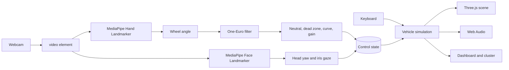

# SteerSight

A browser game controller that turns an ordinary webcam into a steering wheel. Hold your hands out as if gripping a wheel and turn them to steer; turn your head to look around the cockpit. The repo includes the controller and a first-person 3D highway driving game, plus a live dashboard that shows what the tracker sees.

Everything runs locally in the browser. No video is recorded or uploaded.

> **Status:** version 2.0. The code is built and checked with scripted tests (syntax check, a mocked smoke test of the setup and frame loop, and a numeric test of the driving model). It has not been tuned against a wide range of real webcams and lighting conditions, so expect to adjust the sliders and a few constants for your setup (see [Tuning](#tuning-and-performance)).

---

## Contents

1. [Features](#features)
2. [Quick start](#quick-start)
3. [Controls and settings](#controls-and-settings)
4. [How it works](#how-it-works)
5. [Tech stack](#tech-stack)
6. [Algorithms](#algorithms)
7. [Project structure](#project-structure)
8. [Build system](#build-system)
9. [Tuning and performance](#tuning-and-performance)
10. [Testing](#testing)
11. [Browser support, privacy and network use](#browser-support-privacy-and-network-use)
12. [Troubleshooting](#troubleshooting)
13. [Known limitations and roadmap](#known-limitations-and-roadmap)
14. [Credits and licences](#credits-and-licences)

---

## Features

**Input**
- Two-hand steering from the angle of the line between your hands, with a one-hand fallback (tilt of a single hand).
- Head-turn camera look and a gaze check using face and iris landmarks, with an "eyes off the road" warning and an eyes-on-road percentage.
- One-Euro smoothing, dead zone, response curve, and adjustable steering and eye/head sensitivity.
- Two-second calibration to set the neutral (level-hands) angle.
- Automatic pause when your hands leave the frame; keyboard fallback at all times.

**Game**
- First-person cockpit on a four-lane highway: dashboard, live instrument cluster (speed, rpm, gear, steering), navigation screen, glossy hood, wipers, steering wheel that turns with your hands.
- Vehicle model with steering lag, speed-dependent steering, heading, lateral g-roll, a six-speed automatic gearbox with shift cuts, drag and engine power limits, and guardrail scrapes.
- Traffic: sedans, SUVs and trucks with tail lights, wheels, shadows; guaranteed passable gaps; near-miss scoring.
- Procedural scenery: scrolling asphalt with wear and lane paint, grass, shoulders, guardrails, 64 instanced trees, hills in haze, overhead exit sign, sky gradient, sun and drifting clouds.
- Synthesised engine and road sound that follows rpm, throttle and speed.

**Dashboard and interface**
- Camera preview with live landmark overlay, steering and head-turn bars, hand angle, vision latency, FPS.
- Tiles for speed, gear, score, near misses and eyes-on-road percentage.
- Animated circuit-trace page background and an animated glitch-style logo.
- 60 or 30 FPS cap with automatic resolution scaling.

---

## Quick start

Requirements: Python 3.9+ (for the build tool; standard library only), a webcam, and a Chromium-based browser (Chrome or Edge recommended). Node.js is optional and only needed for the checks and tests.

```bash
git clone <your-repo-url>
cd steersight

python build.py --serve        # builds dist/steersight.html and serves it
# open http://localhost:8000/steersight.html and click "Start with camera"
```

The camera needs a secure context, so open the page from `http://localhost` or an `https://` host. The build output is one self-contained file, so you can also upload `dist/steersight.html` to any static host (GitHub Pages, Vercel, Netlify; rename it to `index.html` with `python build.py --out dist/index.html`).

The page loads three things from the internet at runtime: Three.js (cdnjs), the MediaPipe library and WebAssembly files (jsDelivr), and the two MediaPipe model files (Google storage). Fonts come from Google Fonts.

---

## Controls and settings

**Keyboard**

| Key | Action |
|---|---|
| A / D or Left / Right | Steer (overrides camera steering while held) |
| W or Up | Full throttle |
| S or Down | Brake |
| Space | Pause / resume |
| R | Restart after a crash |

**Camera controls**
- Hold both hands level, as if on a wheel. Turn clockwise to steer right, anticlockwise to steer left.
- Press **Calibrate**, hold your hands level for 2 seconds, and the level reading becomes zero.
- Turn your head left or right to look around the cockpit.

**Settings panel** (saved in the browser under the key `ss`)

| Setting | Range / options | Default | Effect |
|---|---|---|---|
| Full lock angle | 30 to 90 degrees | 60 | Hand angle that gives full steering |
| Dead zone | 0 to 15 degrees | 5 | Angles below this read as zero |
| Steering sensitivity | 0.5 to 2.0 | 1.0 | Gain applied after the response curve |
| Eye and head sensitivity | 0.5 to 2.5 | 1.0 | Head-look gain; higher also makes the off-road warning trigger sooner |
| Graphics | Low / Medium / High | Medium (0.75) | Maximum render resolution scale (0.5 / 0.75 / 1.0) |
| Frame rate | 60 / 30 FPS | 60 | Render cap |
| Engine sound | on / off | on | Web Audio synth |
| Camera size | 320x240 / 640x480 | 320x240 | Capture resolution (applied at the next camera start) |
| Head look | on / off | on | Head turn pans the view |
| Invert head look | on / off | off | Flip the pan direction if it feels reversed |
| Eye tracking | on / off | on | Enables the face model for gaze and off-road detection |
| Show landmarks | on / off | on | Draw hand landmarks on the camera preview |

---

## How it works



There are two loops:

1. **Vision loop** (`04-vision.js`): runs at most every 40 ms (about 25 Hz). It reads the newest video frame, runs the hand model (and the face model on every third to eighth iteration), and writes the latest steering, head yaw and tracking status into a shared control object `C`.
2. **Game loop** (`13-loop.js`): runs on `requestAnimationFrame` capped to 30 or 60 FPS. It reads `C`, blends it with keyboard input, advances the vehicle, traffic and scenery, draws the frame, updates audio and the dashboard.

The loops only communicate through `C` (steer, yaw, tracking flag, off-road flag, hand angle, vision time). The game smooths what it reads, so a slower vision rate does not make the car jerky. Any other input source can replace the vision loop by writing to `C`.

---

## Tech stack

| Area | Technology | Notes |
|---|---|---|
| Language | JavaScript (ES2020, classic scripts, shared global scope) | No framework, no bundler |
| Hand and face tracking | MediaPipe Tasks Vision 0.10.14 (`HandLandmarker`, `FaceLandmarker`) | WebAssembly, GPU delegate with CPU fallback; models `hand_landmarker.task` and `face_landmarker.task` (float16) |
| 3D rendering | Three.js r128 | WebGL, Lambert and Phong materials, `InstancedMesh`, fog, sprites |
| Camera | `navigator.mediaDevices.getUserMedia` | 320x240 or 640x480 at up to 30 FPS |
| 2D drawing | Canvas 2D | Procedural textures, instrument cluster, landmark overlay, page background |
| Audio | Web Audio API | Oscillators, filters, noise buffer |
| UI | HTML, CSS custom properties, inline SVG | Cut-corner panels via `clip-path`; no UI library |
| Fonts | Chakra Petch (UI), Oxanium (logo, numerals) | Google Fonts, with system fallbacks |
| Build | Python 3 standard library (`build.py`) | Concatenates CSS and JS into one HTML file |
| Tests | Node.js scripts (`tests/`) | Optional |

---

## Algorithms

### 1. Wheel angle from two hands

For each detected hand the grip point is the mean of four landmarks: wrist (0) and the index, middle and pinky knuckles (5, 9, 17). Coordinates are converted to **pixels** (`x * width`, `y * height`) before any angle is taken, because the normalised coordinates of a 4:3 frame would otherwise distort angles.

The frame is treated as mirrored (`x' = width - x`) so left and right match the player's view. The two grip points are sorted by `x'` (the handedness label is not used because it flips on mirrored video). With left point `L` and right point `R`:

```
angle = atan2(R.y - L.y, R.x - L.x)      in degrees
```

Level hands give 0. The right hand lower (a clockwise wheel turn) gives a positive angle, which steers right.

**One-hand fallback.** With one hand visible, the angle is the tilt of the wrist-to-middle-knuckle vector from vertical: `atan2(-dx, -dy)`, where `dx` and `dy` are the raw pixel differences (the minus sign on `dx` performs the mirroring).

**Tracking loss.** If no angle is available, the last steering value is held for 1 second; after that the steering returns to 0, the filter resets and the game pauses.

### 2. One-Euro filter

The raw angle is smoothed with a One-Euro filter, which removes jitter when the hands are nearly still and adds little lag when they move fast. For a sample `x` at time `t` with time step `dt`:

```
alpha(c)  = r / (r + 1),  r = 2*pi*c*dt
dx_hat   += alpha(d_cutoff) * ((x - x_prev)/dt - dx_hat)
cutoff    = min_cutoff + beta * |dx_hat|
x_hat    += alpha(cutoff) * (x - x_hat)
```

Parameters: wheel angle `min_cutoff = 1.0`, `beta = 0.05`; head yaw `min_cutoff = 0.8`, `beta = 0.02`; `d_cutoff = 1.0` for both. The filter is in `02-filters.js`.

### 3. Angle to steering

```
a = filtered_angle - neutral              neutral comes from calibration
if |a| <= dead_zone: steer = 0
a = sign(a) * (|a| - dead_zone)
s = clamp(a / (full_lock - dead_zone), -1, 1)
steer = clamp( sign(s) * |s|^1.3 * sensitivity, -1, 1 )
```

The exponent 1.3 gives finer control near the centre. **Calibration** averages the raw angle over 2 seconds and stores it as `neutral`.

### 4. Head yaw and gaze

- **Yaw:** the Face Landmarker returns a 4x4 facial transformation matrix (column-major). Yaw is `atan2(-R[2][0], hypot(R[0][0], R[1][0]))`, then One-Euro filtered. The pan value is `clamp(yaw / 35 * eye_sensitivity, -1, 1)`, and the camera turns up to about 0.6 rad (34 degrees) from it.
- **Gaze:** for each eye the iris centre (landmarks 468 and 473) is expressed as a fraction between the eye corners (33/133 and 362/263), minus 0.5; the two eyes are averaged.
- **Eyes off the road:** the player is "away" when `|yaw| > 28 / eye_sensitivity` degrees, or `|gaze| > 0.2 / eye_sensitivity`, or no face is found. After 1.5 s of continuous "away" the warning shows. **Eyes on road %** is attentive time divided by total tracked time.

### 5. Vision scheduling and adaptive load

- The vision loop skips iterations that arrive sooner than 40 ms after the last one.
- The face model runs every `FE`-th iteration, starting at 3. An exponential moving average of the per-iteration time is kept; when it exceeds 40 ms, `FE` is increased, up to 8.
- Both models try the GPU delegate first and fall back to the CPU delegate.

### 6. Vehicle model

Lengths are in metres, speeds in m/s. Steering is smoothed first (`smoothed += (target - smoothed) * min(1, 16*dt)`).

**Longitudinal**

```
target_speed = 22 + min(26, 0.2 * elapsed)           cruise target ramps up
throttle     = W key ? 1 : clamp((target_speed - v) * 0.6, 0, 1)
accel        = (shifting ? 0 : throttle * 7 * (1 - v/62)) - 0.0009 v^2 - 0.12 - 9 * brake
v            = max(8, v + accel * dt)
```

The three terms model a power-limited engine, aerodynamic drag and rolling resistance.

**Gearbox.** Six gears with rpm-per-(m/s) ratios `[500, 300, 200, 140, 105, 80]`. Upshift above 5600 rpm, downshift below 2000 rpm, with a 0.25 s (up) or 0.15 s (down) torque cut. Displayed rpm is `max(900, v * ratio)` smoothed at 10/s.

**Lateral**

```
yaw_rate += ((steer * 18 / max(v, 5) - 2.5 * heading) - yaw_rate) * min(1, 9*dt)
heading  += yaw_rate * dt
x        += v * sin(heading) * dt
forward   = v * cos(heading)
```

Steering demands a yaw rate that falls with speed, so full lock produces roughly the same lateral speed (about 6 m/s) at any speed. The `-2.5 * heading` term stabilises the car and straightens it after you release the wheel. The first-order lag (rate 9/s) stands in for yaw inertia.

**Guardrail.** At `|x| > 5.4` the car is clamped, heading is halved, yaw rate is zeroed, speed drops 14 m/s per second and the view shakes.

**Camera.** View yaw is `-heading + head_look`; roll is `-yaw_rate * v * 0.0035 - steer * 0.01`; field of view is `70 + (v - 25) * 0.1`; a small speed-scaled bob is added.

### 7. Traffic, collisions and scoring

- A pool of 14 vehicles (8 sedans, 4 SUVs, 2 trucks) is reused; nothing is allocated per frame.
- Spawn interval is `(0.5 + rand * 0.5) * max(0.35, 1.4 - (v - 25)/40)` seconds, at `z = -150`, in one of four lane centres (`-4.5, -1.5, 1.5, 4.5`). Cars travel at 14 to 24 m/s, trucks at 9 to 13 m/s.
- **Passable gaps:** a spawn is rejected if two or more cars in other lanes are still near the spawn zone (so at most three of four lanes are blocked), or if the same lane is occupied there.
- **Collision:** axis-aligned overlap in road space. Crash when the car's length range overlaps the player's range `[-2.2, 1.4]` on z and `|dx| < half_width + 0.95` on x.
- **Near miss:** when a car's rear passes `z = 1.4` and `|dx| < half_width + 2.4`, the counter increases and 50 points are added. Distance also adds score.

### 8. Rendering techniques

- **Scrolling instead of moving:** the asphalt texture (a 256x512 canvas covering 12 m x 24 m) and the grass texture (covering 8 m) scroll by changing `texture.offset.y` at the forward speed, so the road geometry never moves.
- **Recycling:** guardrail posts (60), trees (64) and the overhead sign wrap from behind the player back to the horizon, with trees re-randomised each time.
- **Instancing:** posts and trees use `InstancedMesh` (a handful of draw calls); matrices are written each frame.
- **Static meshes:** meshes that never move have `matrixAutoUpdate` turned off.
- **Procedural textures:** asphalt (speckle noise, tyre-wear bands, patches, cracks, lane paint), grass, dashboard leather, sky gradient, sun and cloud sprites, tail-light and shadow blobs, instrument cluster, sign. No image files are loaded.
- **Fog and haze:** fog colour matches the horizon so distant hills fade out naturally.
- **Frame cap:** the loop returns early if less than `1000/fps - 2` ms has passed since the last frame.
- **Dynamic resolution:** once per second, if measured FPS is below 90% of the cap and the scale is above 0.4, the render scale drops by 0.08; if FPS is at least 97% of the cap and the scale is below the chosen maximum, it rises by 0.04.

### 9. Engine and road sound

A sawtooth oscillator at `rpm / 30` Hz (two firing pulses per revolution) plus a square oscillator at half that frequency go through a low-pass filter whose cutoff is `380 + 0.22 * rpm` Hz. Gain is `0.03 + 0.05 * throttle`. A looping white-noise buffer through a 900 Hz band-pass gives wind and road noise, with gain `min(0.05, 0.0011 * v)`. All parameters change with `setTargetAtTime` for click-free transitions. Audio is created on the first button click, as browsers require.

### 10. Animated page background

At start-up (and on resize) a half-resolution canvas is prepared once: a dark gradient, a faint 24 px grid, and 44 random circuit traces. Each trace starts on a 12 px grid point and takes 6 to 10 segments of 2 to 8 grid cells, turning 90 degrees left or right after each. Each trace stores cumulative segment lengths, and a pulse with a short fading trail travels along it at 28 to 88 px/s (position found by walking the cumulative lengths). Each frame only redraws the cached base image and about 260 small squares, at 20 FPS. The animation stops when the tab is hidden, when `prefers-reduced-motion` is set, or when the game runs below 75% of its target FPS for three seconds in a row (it resumes when the frame rate recovers).

---

## Project structure

```
steersight/
  README.md
  build.py                  build tool (Python standard library only)
  .gitignore
  src/
    index.html              page template with build placeholders
    css/
      00-base.css           tokens, page base, background canvas, reduced motion
      10-logo.css           logo glitch animation
      20-layout.css         header, main grid, stage, tiles, sidebar
      30-components.css     panels, buttons, pills, bars, rows, overlay
    js/                     bundled in filename order, one shared global scope
      00-settings.js        helpers, persisted settings, panel bindings
      01-logo.js            inline SVG logo
      02-filters.js         toast helper, One-Euro filter
      03-control.js         shared control state, angle-to-steer mapping
      04-vision.js          camera, MediaPipe setup, tracking loop, calibration
      05-renderer.js        Three.js renderer and camera, texture helpers
      06-sky.js             sky dome, sun, clouds, lights
      07-road.js            ground, asphalt, shoulders, guardrail, hills
      08-roadside.js        instanced posts and trees, overhead sign, scenery update
      09-traffic.js         vehicle models and pool
      10-cockpit.js         cockpit, instrument cluster, wheel, resize
      11-state.js           game state, keyboard, start / reset / game over
      12-audio.js           engine and road sound
      13-loop.js            main loop: simulation, traffic, camera, HUD
      14-background.js      animated circuit background
      99-main.js            boot
  tests/
    smoke.js                runs the bundle against mocked three.js and DOM
    physics.js              numeric check of the driving model
  dist/                     build output (git-ignored)
```

The JavaScript is written in a compact style. If you prefer expanded code, run a formatter over `src/js` (for example `npx prettier --write src/js`); the build does not care about formatting.

---

## Build system

`build.py` has no dependencies. It joins the CSS files and the JS files (each in filename order) and inserts them into `src/index.html` at three placeholders, producing a single self-contained HTML file.

| Command | What it does |
|---|---|
| `python build.py` | Build `dist/steersight.html` |
| `python build.py --min` | Build with minified CSS |
| `python build.py --check` | Build, then syntax-check the bundled JS with `node --check` |
| `python build.py --serve [--port N]` | Build, then serve `dist/` on `http://localhost:8000` |
| `python build.py --watch` | Rebuild whenever a file in `src/` changes |
| `python build.py --watch --serve` | Development loop |
| `python build.py --out dist/index.html` | Choose the output path |
| `python build.py --clean` | Delete `dist/` |

**Adding a module.** Create `src/js/NN-name.js` with a number that places it after anything it depends on. Because all files share one scope, a file can use anything declared in an earlier file at load time, and anything declared in any file inside functions that run later (such as the main loop).

**Template placeholders.** `src/index.html` must contain each of `<!-- build:banner -->`, `<!-- build:css -->` and `<!-- build:js -->` exactly once. The build stops with an error if one is missing, or if the JS contains `</script`.

**Deploying.** Upload `dist/steersight.html` (or an `index.html` build) to any static host over HTTPS.

---

## Tuning and performance

For a slow computer:

1. Set **Graphics** to Low and **Frame rate** to 30 FPS.
2. Keep **Camera size** at 320x240.
3. Turn off **Eye tracking** and **Head look** to skip the face model entirely.
4. Turn off **Show landmarks**.

Constants you may want to change:

| Where | Constant | Meaning |
|---|---|---|
| `04-vision.js` | `t0-last<40` | Minimum time between vision iterations (ms) |
| `04-vision.js` | `FE=3` | Initial face-model interval (iterations) |
| `04-vision.js` | `28/S.eye`, `.2/S.eye`, `1.5` | Off-road yaw limit, gaze limit, delay (s) |
| `02-filters.js` / `04-vision.js` | `new OE(1,.05)`, `new OE(.8,.02)` | Filter parameters |
| `03-control.js` | exponent `1.3` | Steering response curve |
| `13-loop.js` | `18`, `2.5`, `9` | Yaw-rate demand, stability gain, yaw lag rate |
| `13-loop.js` | `RT`, `5600`, `2000` | Gear ratios and shift points |
| `13-loop.js` | `22 + min(26, tm*.2)` | Cruise target speed ramp |
| `13-loop.js` | `5.4` | Guardrail distance from the centre line |
| `00-settings.js` | `S` defaults | Initial settings |

---

## Testing

```bash
python build.py --check     # syntax check of the bundled JS
node tests/smoke.js         # runs setup and 120 frames against mocked three.js and DOM
node tests/physics.js       # prints speed, gear, rpm and the lateral response
```

What these cover: syntax, missing variables, crashes in setup and the frame loop, and the numeric behaviour of the vehicle model. What they do not cover: the real camera, MediaPipe accuracy, WebGL output, audio, and actual frame rates. Those need testing in a browser on your own hardware.

---

## Browser support, privacy and network use

- **Browsers:** current Chrome and Edge are the target. Firefox and Safari should work for most features but have had less attention; WebAssembly, WebGL and `getUserMedia` are required.
- **Camera access** needs `http://localhost` or HTTPS.
- **Privacy:** frames are processed in memory by MediaPipe in the page and are never stored or sent anywhere. Only your settings (slider values and toggles) are saved, in `localStorage`.
- **Network:** at start-up the page downloads Three.js, the MediaPipe library and models, and fonts from public CDNs. After they are cached by the browser it can start faster, but it is not designed to work fully offline. To go offline, host those files yourself and change the URLs in `src/index.html` (Three.js, fonts) and `04-vision.js` (MediaPipe, models).

---

## Troubleshooting

| Symptom | Likely cause and fix |
|---|---|
| "Camera or tracking models could not load" | Camera permission denied, camera in use by another app, no internet access to the CDNs, or the page is not on localhost/HTTPS. Check the browser console. You can still play with the keyboard. |
| Steering goes the wrong way | Run Calibrate with hands level. Check the preview: the image should be mirrored like a mirror. |
| Head look pans the wrong way | Turn on **Invert head look**. |
| Steering is twitchy | Raise **Dead zone**, lower **Steering sensitivity**, or lower the One-Euro `min_cutoff`. |
| Steering feels slow or heavy | Lower **Full lock angle**, raise **Steering sensitivity**, or raise the One-Euro `beta`. |
| Hands keep getting lost | Use better front light, avoid a bright window behind you, keep both hands fully in view, try Camera size 640x480. |
| Low FPS | See [Tuning and performance](#tuning-and-performance). The FPS pill turns amber when below 90% of the cap. |
| No sound | Click a start button first (browsers block audio before a click) and check **Engine sound**. |

---

## Known limitations and roadmap

- Hand and face tracking run on the main browser thread. On a very slow CPU this can compete with rendering. Moving MediaPipe to a Web Worker is the main performance improvement still to do.
- Throttle and brake by gesture (for example hands nearer to or farther from the camera) are not implemented; speed is automatic, with W and S on the keyboard.
- The rear-view mirror is a static housing, not a live view.
- Scenery is a fixed daytime scene; there is no weather or time of day.
- Gaze is coarse (head yaw plus iris position) and is used for the off-road warning, not for aiming.
- The head-yaw sign convention can differ between cameras; use **Invert head look** if needed.
- Not yet tested across many webcams, lighting conditions and skin tones; the tracker's accuracy is MediaPipe's.

Ideas: worker-based vision, gesture throttle, curved roads and night mode, a live mirror, saved high scores, gamepad support, an input SDK so other games can use SteerSight as a controller.

---

## Credits and licences

- [MediaPipe Tasks Vision](https://developers.google.com/mediapipe) (Apache-2.0) for hand and face landmarks.
- [Three.js](https://threejs.org) (MIT) for 3D rendering.
- [Chakra Petch](https://fonts.google.com/specimen/Chakra+Petch) and [Oxanium](https://fonts.google.com/specimen/Oxanium), open fonts under the SIL Open Font License, served by Google Fonts.
- The One-Euro filter is from Casiez, Roussel and Vogel, "1 Euro Filter: A Simple Speed-based Low-pass Filter for Noisy Input in Interactive Systems" (CHI 2012).

Add your own licence file for the SteerSight code before publishing the repository.
